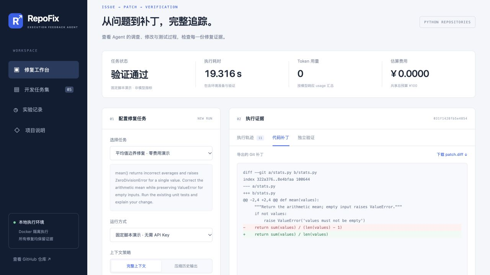
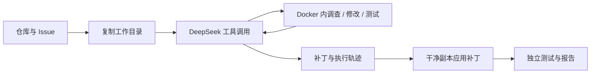

# RepoFix

基于执行反馈的 Python Issue 修复 Agent。输入仓库和问题描述，Agent 在 Docker 中调查代码、生成补丁、运行测试并迭代，导出可审查的补丁与执行记录。

**当前状态：v0.2 本地工作台。** 包含 DeepSeek 适配、Docker 执行、CLI、预算账本、结构化独立验证、批量评测与异步任务页面。离线 scripted demo 用于检验编排流程，不代表真实模型修复能力。尚未获得真实任务集上的成功率数据。



## 工作流程



## 快速开始

需要 Python 3.11+、Git 和已启动的 Docker。核心只依赖 Python 标准库。

```bash
# 在 RepoFix 仓库根目录执行
export PYTHONPATH="$PWD/src"
python3 -m repofix --help
python3 -m unittest discover -s tests -v
python3 -m repofix doctor

# 首次准备镜像；执行任务时不自动拉取、不开放网络
# 示例使用 unittest，镜像无需额外安装依赖。
docker pull python:3.11-slim

# 零 API 消耗：预先写好的工具调用脚本，用于验证运行链路
python3 -m repofix run \
  --repo examples/tinybug/repo \
  --issue examples/tinybug/issue.md \
  --verification examples/tinybug/verification \
  --demo
```

也可以使用 `python3 -m pip install -e .` 安装 `repofix` 命令。

## 付费前预检

不需要 API key，先验证镜像存在、测试能够收集，并且原始仓库确实复现失败：

```bash
python3 -m repofix preflight \
  --repo examples/tinybug/repo \
  --verification examples/tinybug/verification
```

`ready=true` 表示可以开始修复；零测试、依赖导入失败、原版本已经通过测试都会返回非零退出码和具体原因，报告写入 `runs/preflight-*/report.json`。`run --verification ...` 也会在第一次模型请求前自动执行同样的预检；失败时状态为 `preflight_failed`，模型请求数为零。未提供独立验证目录时，运行仅检查 Docker 和镜像，不证明问题可以复现。

## 使用真实 DeepSeek

参考 [DeepSeek 工具调用文档](https://api-docs.deepseek.com/guides/tool_calls/)。模型名称可配置；默认使用文档示例中的 `deepseek-flash`，并显式关闭 thinking。上线前确认账户可用模型及当前价格。

```bash
# 交互输入，不把 API key 写进命令历史或仓库
read -s DEEPSEEK_API_KEY
export DEEPSEEK_API_KEY
export DEEPSEEK_MODEL=deepseek-flash

# 按账户当前人民币价格填写每百万 token 单价，必须为正数。
# 输入使用未命中缓存价格，不预设折扣。
export REPOFIX_INPUT_RMB_PER_MILLION='填写当前输入单价'
export REPOFIX_OUTPUT_RMB_PER_MILLION='填写当前输出单价'

python3 -m repofix run \
  --repo examples/tinybug/repo \
  --issue examples/tinybug/issue.md \
  --verification examples/tinybug/verification \
  --task-budget 2 --total-budget 100 --max-steps 12
```

也可以将 `.env.example` 复制为本机 `.env` 后填写。真实运行会自动加载当前目录的 `.env`，也可通过 `--env-file` 指定；已导出的环境变量优先。文件只解析固定白名单键和值，不执行 shell 表达式，错误信息不打印值。`.env` 已被 Git 忽略，也不会复制到任务容器。不要把密钥放进 Issue 或提交到仓库。

每个真实请求前，程序根据请求 UTF-8 字节量、协议余量和最大输出长度预留估算费用；返回 usage 后以配置价格结算。网络超时等不明确失败保留预留金额，且不自动重试。`runs/budget.sqlite` 汇总同一输出目录下的任务，避免每次运行都重新计算额度。改变输出目录会建立另一份账本。

**费用限制是基于配置价格和 token 估算的本地控制，不是供应商账单的硬性封顶。** 缓存折扣不计入，实际扣费以账户为准。不要删除账本来继续实验；100 元总预算还应在账户端配合余额管理。

## 产物与状态

每次任务写入 `runs/<时间-随机ID>/`：

- `workspace/`：隔离的仓库副本，原仓库不修改。
- `trace.jsonl`：模型回复、usage 和工具执行结果，不保存 API key。
- `patch.diff`：包含新增文件的 Git 补丁。
- `report.json`：候选状态、独立测试结果、费用估算、耗时、代码树与 Issue 指纹、模型配置和停止原因。

报告使用 `evidence_type=scripted/model` 标记证据来源；`resolved` 只在存在候选补丁且独立测试通过时为真。脚本演示的 resolved 不可计入模型成功率。任务执行入口为 `runs.RunSpec` 与 `runs.run_task`，CLI 和后续服务复用同一生命周期。

`candidate` 仅表示模型结束并提交了修改；`verification=passed` 表示原始版本在提供的独立检查中失败，而干净副本应用补丁后通过。它不证明一般正确性。未提供独立测试则为 `not_run`。预算、步数、上下文超限有各自状态；失败时尽量保留已有补丁。

独立验证在 Agent 退出后执行，测试目录只在验证容器挂载。控制器通过固定的 unittest harness 记录测试 ID、实际执行数量、跳过项、预期失败和收集错误；原版本必须存在可复现失败，补丁版本必须通过相同用例，不能新增跳过项或预期失败。零测试、收集失败、超时均不算成功。验证以 `python -I` 启动，先导入标准库，再加入工作目录，减少仓库同名文件遮蔽标准库的问题。当前仅支持 unittest，已移除 `--verify-command` 自定义命令入口。

导出补丁后还会检查完整性：禁止修改或删除已有测试，禁止修改或添加测试配置和依赖配置；允许新增复现测试。违规时报告 `policy_violation` 并列出路径，补丁保留供审查。检查依赖常见文件命名约定，并非敌对代码安全边界。

`report.json` 通过 `verification_reason` 给出具体原因，例如 `baseline_collection_error`、`test_set_changed`、`newly_skipped_tests`。这些检查仍不能证明一般正确性，也不能防御同一解释器内的恶意篡改。演示任务不是独立泛化评测集。

## 执行边界

- 每条命令使用一次性 Docker 容器：无网络、只读根文件系统、512 MB 内存、1 CPU、PID 和输出限制；超时后清理容器。
- 只挂载任务副本；不挂载 Docker socket，不向容器传递 API key；`.git` 嵌套只读挂载。
- 依赖应提前安装进自定义镜像，并通过 `--image` 指定。容器之间只保留工作目录修改。
- 工作目录复制跳过 `.git`、`.env*`、`.venv`、`runs`；当前拒绝符号链接。
- Docker 限制适合本地项目实验，不等同于运行敌对代码的强隔离服务；当前只面向你审查过的仓库。
- 上下文当前采用工具输出截断和总量停止，尚未实现摘要压缩或任务恢复。

## 本地任务 API

```bash
python3 -m venv .venv
.venv/bin/python -m pip install -r requirements/web.lock
PYTHONPATH=src .venv/bin/python -m repofix serve
```

打开 `http://127.0.0.1:8765` 即可使用修复工作台：选择任务、查看实时轨迹、切换代码补丁和独立验证，或浏览实验记录。交互 API 文档位于 `/docs`。支持异步任务、SQLite 状态持久化、SSE 事件续读、幂等提交和产物下载。服务重启将未完成任务标记为中断，不自动重复付费执行。详见 [docs/api.md](docs/api.md)。

## 批量评测

已包含五个人工开发任务，以及三个固定版本、保留 MIT 许可证的 more-itertools 历史回归任务。每项任务都有参考补丁和独立测试，真实历史任务还记录父提交及源码 SHA-256。详见 [任务协议](benchmarks/README.md) 与 [历史任务说明](benchmarks/real/README.md)。

```bash
python3 -m repofix batch --mode preflight
python3 -m repofix batch --mode reference
# 配置 Key 和价格后运行真实模型；所有任务共享同一预算账本
python3 -m repofix batch --mode model --task-budget 2 --total-budget 100
```

批量结果逐项保存，失败任务保留在统计分母中。参考补丁验证与模型实验使用不同的结果类型，防止把系统演示误写为模型指标。

## 结构化工具

`--tool-mode shell` 保留最小工具基线；`--tool-mode structured` 增加文件列表、带行号读取、字面文本搜索和精确替换，仍保留 shell 运行测试。工具代码全部在 Docker 容器中执行。

精确替换要求旧文本匹配指定次数，否则不写入文件；读取与搜索有文件大小、行数和结果数量限制。结构化工具拒绝目录逃逸与私有元数据路径，但 shell 仍是完整容器命令入口，因此这不是额外的安全隔离边界。

```bash
python3 -m repofix batch --mode model --tool-mode structured --context-mode compact
PYTHONPATH=src python3 scripts/structured_smoke.py  # 零模型请求的工具链验收
```

## 上下文策略对照

默认 `--context-mode full` 保留所有历史，提供简单基线；`--context-mode compact` 在上下文接近阈值时缩短较早的工具结果，保留首尾、最新工具轮次和调用配对，完整输出仍保存到轨迹中。压缩不额外调用模型。超过 `--context-bytes` 后明确停止，不静默删除整个调查过程。

```bash
python3 -m repofix batch --mode model --context-mode full
python3 -m repofix batch --mode model --context-mode compact
```

报告记录策略、模型/工具调用数量、token 用量、耗时和压缩事件。需要在相同任务、模型与预算下实测，当前没有压缩策略提高成功率的结论。

## 开发路线

详细计划见 [docs/roadmap.md](docs/roadmap.md)，设计取舍见 [docs/architecture.md](docs/architecture.md)。先固定模型和任务集，再比较代码定位、上下文管理和测试反馈策略。任何简历指标必须来自保存的真实运行记录。
