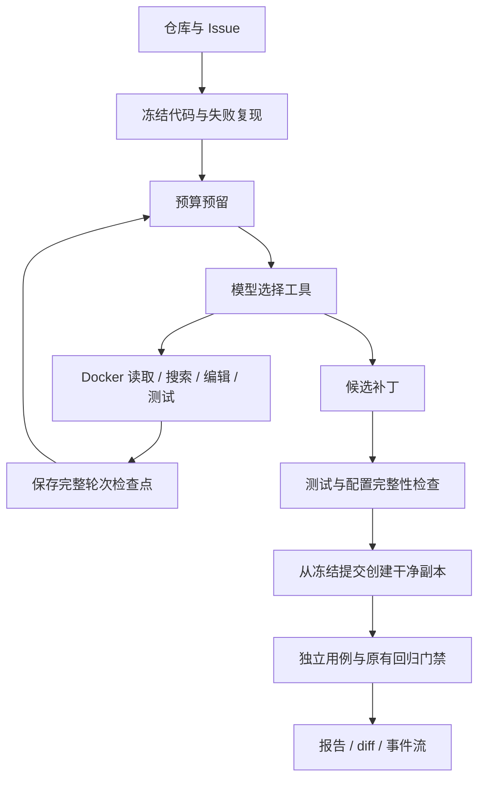

# 面试讲解与代码阅读

## 两分钟讲解顺序

先给一个具体任务：Python 函数在边界输入下出错。模型通过检索和执行反馈定位问题、修改代码、运行测试；控制器负责环境、预算、终止与验收。最后展示 diff、一次失败反馈、独立测试及原有回归结果，再说明实验范围。

当前页面演示是固定脚本，讲解时应明确它证明系统流程；真实模型效果需要另外运行并展示。

## 常见追问

| 问题 | 回答要点 | 代码 |
|---|---|---|
| Agent 的决策在哪里？ | 模型依据前一步结果选择工具与参数，控制器执行后将结果配对返回；终止和验收由程序决定。 | [agent.py](../src/repofix/agent.py) |
| 为什么先用一个 Agent？ | 当前重点是把定位、编辑、测试反馈和归因做清楚；单一执行循环便于建立基线，再比较工具与上下文策略。 | [tools.py](../src/repofix/tools.py) |
| 这里如何利用检索？ | 函数名、路径和报错常有精确线索，因此先实现字面搜索和按行读取。只有实际失败案例证明需要时，再考虑语义索引。 | [tools.py](../src/repofix/tools.py) |
| 压缩会不会丢信息？ | 会。当前保留较早输出首尾、最新工具轮次和调用配对；需要细节时重新检查源码，完整输出供人审查。没有实测前不声称效果提升。 | [context.py](../src/repofix/context.py) |
| 为什么不能只看 pytest/unittest 退出码？ | 零测试、收集失败、用例替换或新增跳过都可能误导。门禁同时检查用例身份、数量、跳过项和原有测试新增失败。 | [evaluation.py](../src/repofix/evaluation.py) |
| 模型自己写的测试能证明修好了吗？ | 可用来复现和定位，最终仍需独立测试；测试覆盖范围有限，所以通过也不等于一般正确性。 | [runs.py](../src/repofix/runs.py) |
| 如何避免删改测试过关？ | 最终比较已有测试及配置文件差异；独立测试只在验证容器挂载，候选补丁应用到另一份干净代码上。 | [workspace.py](../src/repofix/workspace.py) |
| API 超时后能直接重试吗？ | 请求可能已计费，因此保留预留金额，不自动重复请求；预算是本地估算，实际扣费以账户为准。 | [budget.py](../src/repofix/budget.py) |
| 能保证任意中断后恰好执行一次吗？ | 当前只恢复已完整结束的轮次；一轮可能仍在执行时拒绝自动重放，不能宣称任意崩溃下的 exactly-once。 | [checkpoint.py](../src/repofix/checkpoint.py) |
| 页面断线怎么办？ | SQLite 保存事件序号，SSE 支持 Last-Event-ID 续读；幂等键避免未确认提交被重复创建。 | [api.py](../src/repofix/api.py) / [jobs.py](../src/repofix/jobs.py) |
| 为什么不用分布式队列？ | 当前是本地单用户实验，一进程一执行线程已足够。跨进程预算事务已验证，任务服务通过进程锁限制单个所有者。 | [jobs.py](../src/repofix/jobs.py) |
| 数据能代表真实能力吗？ | 5 个任务是人工开发题；3 个历史任务来自同一个公开库，样本小且可能被模型记忆，需要报告范围并扩充独立任务。 | [历史任务说明](../benchmarks/real/README.md) |

## 两个可讲解的真实工程问题

**输出通道交错。** Docker 的 stdout/stderr 交错曾使结构化结果记录接在测试输出中间，导致解析失败。验证 harness 改为同一输出流，并给最终记录增加明确边界；新增无换行输出场景的测试。

**损坏的字节码缓存。** 原有回归测试导入出现 EOFError。预检正确停止了任务，定位后将字节码缓存路径隔离到容器临时目录，并禁止写入；还增加了损坏缓存的验收用例。这是系统环境问题，不应被算成模型修复失败。

## 建议阅读顺序

1. `agent.py`：消息协议、工具调用循环与停止条件。
2. `tools.py`、`sandbox.py`：参数检查、精确替换和执行边界。
3. `evaluation.py`、`preflight.py`：如何避免误判成功。
4. `budget.py`、`checkpoint.py`：成本未知状态与保守恢复。
5. `runs.py`、`benchmark.py`、`experiments.py`：任务生命周期和对照实验。
6. `api.py`、`jobs.py`：本地异步接口、幂等和事件续读。
